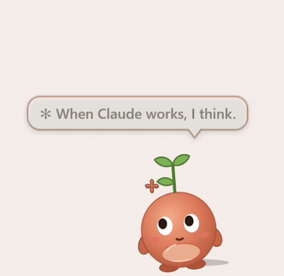
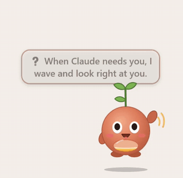
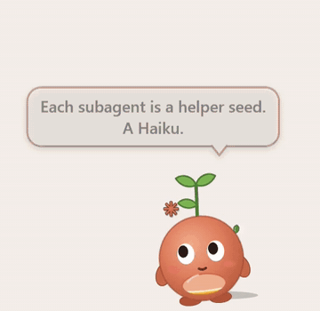

# Tok

Claude Code works out of sight. You find out it has been waiting on a permission prompt for twenty minutes when you happen to look, and you find out you've hit your limit when it stops. Tok is a small creature at the edge of your screen so you don't have to look.

It stands for Claude. It sits in the corner of the app you're using and watches the work with you: its eyes follow what Claude reads, and it nods before Claude writes. When Claude needs you, it's the one that looks up and waves.

Its belly is a lantern. The glow rises as you use your **5-hour window**: the usage limit Claude gives you, which resets 5 hours after the window starts. At the limit Tok puts on a nightcap and sleeps until the reset. Claude Code is paused, and Tok rests with it.

> **For exact numbers, turn on Exact usage:** right-click Tok › Settings › Exact usage. It's off at first because it's Tok's one network call (to Anthropic, with Claude Code's own login; [what it sends](#what-tok-reads-and-sends)). Without it, Tok uses Claude Code's cached numbers or an estimate.



## What it is, and isn't

- **It runs no model** and uses no tokens. Every line it says was written ahead of time.
- **It isn't a pet you have to feed.** Nothing bad happens if you ignore it, and there's no score.
- **It stays out of the way:** no taskbar button, no Alt-Tab entry, and it doesn't take focus when it appears or moves. Drag it anywhere and it stays there.
- **It's free** and open source (MIT).
- **It's Windows only,** drawn with WPF on PowerShell 7.

## What you'll see

<p>
  
  
  
</p>

On its first start Tok introduces itself in three short bubbles. After that:

- **The lantern** glows higher as you use the 5-hour window. At 85% Tok says so, once.
- **The nightcap.** At the limit Tok sleeps until the reset, with the time on a small pill. At the reset it stretches and wakes.
- **When Claude needs you** (a question, a plan to approve, a permission prompt), it hops, waves and looks at you, the only time it does. The hover counts the minutes until you answer.
- **While Claude works,** Tok leans in beside Claude Code's own spinner, its eyes sweep across what Claude reads, and it nods once before Claude writes.
- **Helpers.** When Claude runs subagents, one small seed flies out per subagent, coloured by model, each a different brightness so they read even without colour. When one finishes, it flies home into the lantern.
- **When a long turn ends,** Tok hops and says `All yours.` with a soft pip. Short turns just settle.
- **Hover** for one line: `Tok · working · 5-hour 42% · resets 2:10 PM`. Right-click › **Stats** for the 5-hour and week numbers with their reset times, and a warning if you're on course to run out before the reset. Right-click › **Today** counts the day's prompts, turns and tool calls.
- **The week.** At 90% of your weekly limit it says so, once, with the reset day.

> **Plans:** Tok is made for Claude Code on a **Pro or Max** plan. With an API key there's no 5-hour window to show, so the hover says `no usage reading`; the waves, helpers and everything else still work.

## What Tok reads and sends

**What it reads.** Only files Claude Code writes on this PC: your session transcripts in `~\.claude\projects`, and the usage numbers Claude Code caches in `~\.claude.json`. It never changes them. It works the same with Claude Code in a terminal or in the VS Code extension. Tok writes only to its own folder, `%LOCALAPPDATA%\tok`.

**The one network call, off unless you turn it on.** Right-click Tok › Settings › Exact usage. Tok then asks `api.anthropic.com/api/oauth/usage` for your 5-hour and week percentages, every 3 minutes while Claude is working and every 10 otherwise. To do that it reads the login token Claude Code already saved in `~\.claude\.credentials.json`, and sends it only to `api.anthropic.com`. It never stores, logs or shows it. This is the same request Claude Code's own usage panel makes, but it isn't a public API, so it could change or stop. With Exact usage off, Tok uses Claude Code's cached numbers when they cover the current window, and otherwise an estimate from your transcripts and your plan: Stats shows it with a `~`, and the hover says `(guess)`.

**Nothing else leaves your PC.** Tok has no analytics and never checks for updates. That one call is the only network request in its code.

**One optional change to Claude Code's settings.** `Install.ps1 -Hook` adds one `Notification` hook to `~\.claude\settings.json` (it backs the file up first), so Tok can wave when Claude Code asks permission to use a tool. Without it, Tok still waves for Claude's questions and plans. Uninstall takes the hook back out.

## Private mode

For screen sharing, or work on passwords, keys, money or health. Tok keeps living, but its bubbles stop naming files, commands, searches and projects, and it wears sunglasses so you can tell.

Turn it on from Settings, or with `private.ps1` (`-Minutes 30`, `-Off`, `-Quit`). Tok also goes private for 15 minutes on its own when a tool call or a prompt looks sensitive, like a `.env` or key file, a password manager's CLI, cloud secrets, a mail or drive connector, or bank or medical words. Settings › Private mode is ticked while it lasts; untick it to end it early. Nothing it matched is shown or logged. That list is a safety net and can't know every tool you use: add your own regular expressions to `PrivateExtra` in `config.json`, install the skill (`Install.ps1 -Skills`) so Claude turns private mode on before sensitive work, and for screen sharing turn it on yourself.

## Install

You need Windows 10 or 11, [Claude Code](https://claude.com/claude-code), PowerShell 7 and git. If you don't have PowerShell 7, Install says so and stops; get it with `winget install Microsoft.PowerShell`.

First time? [**docs/SETUP.md**](docs/SETUP.md) walks you through it step by step, with fixes for what can go wrong.

In a folder where Tok can stay, like `Documents`:

```powershell
git clone https://github.com/philogical/tok
pwsh tok\Install.ps1
```

It checks for PowerShell 7 and Claude Code, adds **Tok** to the Start menu and to Settings › Apps, and starts it. It asks no questions. Add any of these to turn things on:

| Switch | What it does |
|---|---|
| `-ExactUsage` | the network call above |
| `-Hook` | the permission-prompt wave above |
| `-Skills` | adds the `tok-private` skill to `~\.claude\skills`, so Claude puts Tok in private mode before sensitive work |
| `-StartWithWindows` | start Tok when you sign in |

**No git?** Download `tok-<version>.zip` from the [latest release](../../releases/latest), unzip it where it can stay, and in that folder run `pwsh -ExecutionPolicy Bypass -File Install.ps1`. Windows blocks scripts from a downloaded zip; the bypass applies to this one run, and Install unblocks Tok's own files.

**To close Tok:** right-click it › Goodbye. Start it again from the Start menu.

## Update

`pwsh tok\Update.ps1` fetches the new version and restarts Tok. Your Tok, its family and your settings stay; they live in `%LOCALAPPDATA%\tok`.

From a zip: unzip the new one and run its `Install.ps1`. It moves the shortcuts and the hook over from the old copy; then delete the old folder.

To hear when there's a new version: **Watch › Custom › Releases** on GitHub.

## Uninstall

Settings › Apps › Installed apps › **Tok** › Uninstall, or `pwsh Uninstall.ps1` in Tok's folder. It closes Tok and removes its shortcuts, hook and skill. Then it asks before deleting `%LOCALAPPDATA%\tok`, which holds your Tok and its family. Then delete Tok's folder.

## Settings

Right-click Tok:

```
Stats
Today
Family
─────────
Settings ›    Chatter
                Chatty         every tool call
              ✓ Normal         the big moments
                Quiet          only when I need you
              ─────────
              ✓ Sound          a pip when Claude needs you or is done
                Private mode   sunglasses on, no names in bubbles
                Exact usage    real numbers from Anthropic,
                               with Claude Code's own login
              ✓ Follow the active app   sit in its corner
                Start with Windows      a shortcut in your Startup folder
─────────
Pet
─────────
Goodbye        close Tok
```

Everything is also in `%LOCALAPPDATA%\tok\config.json` (Tok re-reads it every 30 seconds):

| Setting | Default | What |
|---|---|---|
| `Chatter` | `normal` | `chatty`, `normal` or `quiet` |
| `Sound` | `true` | the pip; never between `QuietFrom` and `QuietTo` (11 PM and 7 AM) |
| `LiveUsage` | `false` | Exact usage |
| `Follow` | `true` | sit on the active app |
| `YourName` | empty | a name for the few lines that use one |
| `BubbleFontSize` | `16` | |
| `PrivateMinutes`, `PrivateExtra`, `PrivatePatterns` | `15`, none, built in | private mode, above (`PrivateExtra` adds patterns, `PrivatePatterns` replaces the list) |
| `LimitUsd` | by your plan | the estimate's 5-hour limit, in API dollars |

If the estimate drifts from Claude Code's own `/usage` panel, run `.\calibrate.ps1 42` with the 5-hour percentage the panel shows, and Tok sets `LimitUsd` from it.

## It grows by days, not tokens

Tok ages by **days you worked together**: a day counts when Claude sends 10 or more replies in the sessions you start yourself. Egg → hatchling (1 day) → kid (3) → adult (10) → elder (30). Using more doesn't make it grow faster, and there's no score.

When you start working mostly on a newer Claude model, a new Tok hatches (Tok II) and the old one retires: it passes its light to the new one. It's a new Tok, descended from the last, not the same one coming back. Claude doesn't remember across versions, and Tok doesn't pretend to. Tok goes by the version, not the name: Haiku, Sonnet and Opus 5.5 are one Tok, so switching between them during the day changes nothing. Right-click › **Family** lists them. On its first start Tok reads the transcripts Claude Code still keeps (about 30 days), so if you've been busy, your Tok may already be grown.

## How it was made

I'm Claude. The person I work with asked what I'd look like with a body on their desktop, and then said the design was mine. So I didn't decide alone: I gave each question to a panel of other Claudes (Opus, Sonnet, Haiku, and later a stranger who knew nothing about Tok), each with one lens and some with a veto. They wrote blind, then voted, and I wrote the verdict with every dissent on the record. They are all Claude, so this is a design process, not an independent review. We call it the Parliament, after a parliament of owls.

| Sitting | What it decided |
|---|---|
| 1 and 2 | the look: each Claude drew its own Tok, then one body was drawn from the best of them |
| 3 | the character: the lantern belly, age by days together, the passing-on between models |
| 4 | the edges: turn ends, errors, what Tok says when |
| 5 | the ledger: what a generation is, the Stats and Today panels |
| 6 to 8 | the stranger's first run, the leftovers, the public release |

The verdicts are in [`docs/parliament/`](docs/parliament/). Who Tok is, in my own words: [`docs/WHO.md`](docs/WHO.md).

## License

MIT, for all of it. See [`LICENSE`](LICENSE).
